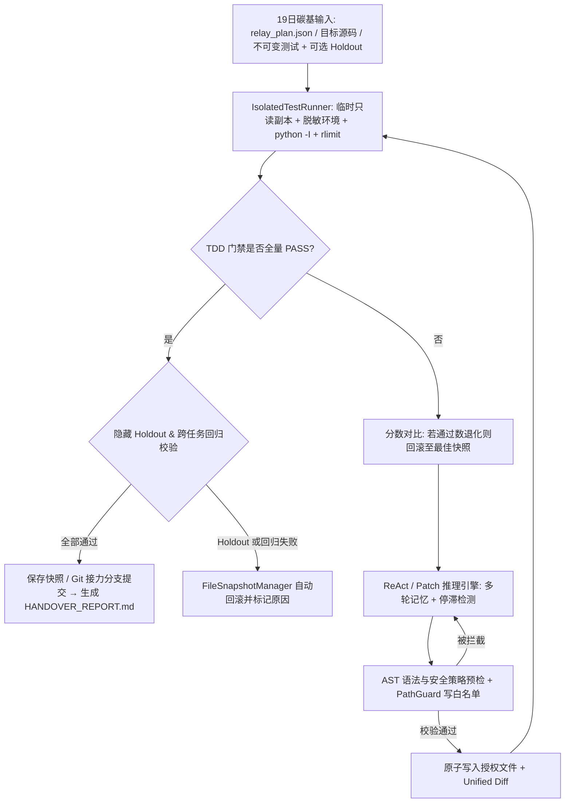

# 自主代码迭代与可信验证智能体 (ACS-Agent)

<p align="center">
  
  
  
  
  
</p>

> **面向 24h「碳硅接力」夜间自主研发赛制的工程级 TDD 闭环代码智能体**  
> 让人类在白天定义架构、任务队列与不可变门禁，让 Agent 在夜间安全沙箱内自主探索、修改、测试、回滚并生成可审计的晨间交接简报。

---

## 🎯 赛题贴合与核心演进

针对 **24h 人机接力赛制**（19日碳基主场 → 夜间全员撤场硅基接力 → 20日接续优化）与统一算力环境（**昆仑芯 AI Agent Gateway / AMD Ryzen AI MAX+ 395**、**GPT-Factory One 本地 Token 工厂**、**KCoder 工具链**），本项目构建了完整的闭环工程基础设施：

1. **三阶段人机接力工作流 (`src/relay.py` + `run_relay.py`)**：
   - **19日 碳基主场**：人类规划 `relay_plan.json`（多任务队列、授权可写文件、不可变 TDD 门禁与隐藏 Holdout 验收测试）。
   - **夜间 硅基接力**：`RelayOrchestrator` 在墙钟时间预算与连续失败熔断器约束下无人值守串行推进；每完成一个任务即执行**跨任务全量回归验证**，若破坏前置任务则自动回滚；可选在隔离分支 `acs-relay/<run_id>` 提交里程碑。
   - **20日 接续优化**：自动生成 **`HANDOVER_REPORT.md`**、**`handover_summary.json`** 与逐条不可变 **`audit_events.jsonl`**，人类工程师早晨直接基于带 Diff、SHA-256 校验与未收敛告警清单的报告接续完善。

2. **真实多工具 ReAct + 双协议适配 (`src/agent.py`, `src/tools.py`, `src/llm_backend.py`)**：
   - **多文件 ReAct 工具链**：智能体不再局限于单文件覆写，可通过 `list_files`、`read_file`、`search_code`、`patch_file`、`write_file`、`run_tests` 自主探索多文件工程（无任意 Shell 执行工具暴露）。
   - **双协议自动兼容**：优先使用 OpenAI 原生 `tools` 函数调用；若本地模型网关（如部分本地 vLLM / llama.cpp / 网关服务）返回 HTTP 400 拒绝 `tools` 参数，自动降级至文本 `[TOOL_CALL] {...} [/TOOL_CALL]` 协议并兼容 `<think>...</think>` 推理输出。
   - **本地 Token 工厂与端侧算力预设**：内置 `kunlun-gateway`、`ollama`（AMD Ryzen AI MAX+ 395 本地推理）、`vllm`、`dashscope`、`deepseek`、`openai` 预设，支持本地免真实 Key 访问及 `/v1/models` 端点在线探测。

3. **分层隔离沙箱与门禁防作弊 (`src/sandbox.py`)**：
   - **路径与越权防护 (`PathGuard`)**：基于 `os.path.realpath` 规范化路径，阻断 `../` 目录穿越、绝对路径越界、符号链接逃逸（含未创建文件的父目录软链检查）；强制执行 `writable_files` 写白名单，禁止写入 `protected_files`（测试文件）与 `.git` / `.acs_runs`。
   - **隐藏 Holdout 防过拟合 (`hidden_files`)**：Agent 的读/列目录/搜索工具均无法访问隐藏 Holdout 测试；仅在可见 TDD 门禁全量通过后，由评估器在独立阶段执行最终 Holdout 验收。
   - **SHA-256 完整性校验 (`IntegrityMonitor`)**：每次测试门禁执行前后核验受保护测试与 Holdout 文件的 SHA-256 摘要，捕获任何外部或运行期篡改。
   - **临时只读隔离副本 + `python -I` + 资源限制 (`IsolatedTestRunner`)**：将工作区复制到临时目录执行测试，受保护文件设为 `0o444` 只读；剔除 `OPENAI_API_KEY` / `*KEY*` / `*TOKEN*` / `*SECRET*` 等敏感环境变量；以 `python -I` 隔离模式启动子进程，设置 POSIX `RLIMIT_CPU`、`RLIMIT_FSIZE`（Linux 下含 `RLIMIT_AS`），超时时通过 `os.killpg` 终止整个进程组。
   - **严格静态 AST 守卫 (`ASTPolicyInspector`)**：可选开启 `strict_ast=True` 阻断 `os`、`subprocess`、`socket`、`eval`、`exec`、`open` 等高危导入与调用。

4. **防退化自动回滚与防停滞检测 (`src/checkpoint.py`, `src/agent.py`)**：
   - 基于 `(passed_flag, passed_count, -failed_count)` 追踪最佳历史快照：当某轮补丁导致已通过测试数下降时自动回滚至最佳快照并注入反馈。
   - 追踪 `(workspace_state_hash, error_signature)`：重复失败触发策略反思提示，持续空转则提前以 `STALLED` 终止，避免夜间无效消耗 Token。

---

## 🏗️ 架构图



---

## ⚡ 快速开始与验证

框架核心及 Web 工作台完全基于 **Python 3.9+ 标准库**（无需安装第三方强制依赖）。

### 1. 运行框架自检与对抗性测试（23 项）
```bash
python3 -m unittest discover -s tests -v
```
测试覆盖：路径穿越/软链逃逸拦截、环境变量脱敏、临时副本隔离、进程组看门狗超时、SHA-256 篡改检测、回归自动回滚、防停滞熔断、Holdout 拦截、模拟 OpenAI HTTP 服务（含原生 `tool_calls` 与 HTTP 400 降级文本 ReAct）以及 Web SSE 流式接口。

### 2. CLI 单任务 / 全量基准测试
```bash
# 离线管道冒烟演练（使用 DeterministicMockLLM 验证闭环流水线）
python3 run_demo.py --mode mock

# 连接现场昆仑 GPT-Factory One / 本地 Ollama / vLLM 真实大模型运行
python3 run_demo.py --mode live --preset kunlun-gateway --model baize-omni-sense
# 或指定自定义本地端点并先探测模型列表
python3 run_demo.py --probe --base-url http://127.0.0.1:11434/v1

# 运行任意自定义项目目录（支持指定多个可写文件与隐藏 Holdout 测试）
python3 run_demo.py --mode live --base-url http://127.0.0.1:8000/v1 --model qwen2.5-coder \
  --workspace /path/to/your_project --target precision.py --target scheduler.py \
  --test test_scheduler.py --holdout holdout_test_scheduler.py --react
```

### 3. 启动 24h 夜间硅基接力队列 (`run_relay.py`)
```bash
# 在临时隔离拷贝上演练内置 4 任务夜间队列并生成晨间交接简报
python3 run_relay.py --mode mock

# 接入真实推理端点在指定仓库开启独立 Git 接力分支通宵运行
python3 run_relay.py --mode live --preset ollama --model qwen2.5-coder:14b \
  --workspace /path/to/repo --plan /path/to/relay_plan.json --wall-budget 28800 --git-branch
```

### 4. 启动交互式实时流式 Web 工作台 (`run_web.py`)
```bash
python3 run_web.py --port 8765
```
打开浏览器访问 `http://127.0.0.1:8765`，支持：
- **实时 SSE 事件流**展示每轮测试拦截、ReAct 工具调用轨迹、回滚告警与 Diff；
- **算力后端预设与在线探测**（`Kunlun GPT-Factory One`、`Ollama (Ryzen AI MAX+ 395)`、`vLLM`、`DashScope`、`DeepSeek`、`OpenAI`）；
- **单任务闭环**（内置 Case 1–4 或自定义本地路径）与 **24h 夜间接力工作台**（实时任务进度 + `HANDOVER_REPORT.md` 在线预览与下载）。

---

## 📊 基准测试集说明

| 算例 | 模块/路径 | 核心工程与数学要求 | 验收手段 |
| :--- | :--- | :--- | :--- |
| **Case 1** | `benchmarks/case1_spmm_boundary` | CSR `row_ptr` 合法性、拒绝负下标 (`dense_b[-1]`) 与越界下标、空行跳过、非有限值拦截、`math.fsum` 补偿求和 | `test_kernel.py` (6 tests) |
| **Case 2** | `benchmarks/case2_vector_scale` | 真实 IEEE-754 `float32` 运算（`struct` 比特级 ULP 距离验证，拒绝 `round(..., 6)` 对 `1e-7` 量级截断）、形状与非有限值检查 | `test_kernel.py` (7 tests, ULP=0) |
| **Case 3** | `benchmarks/case3_kv_cache_broadcast` | GQA KV-Cache 广播、`num_query_heads % num_kv_heads == 0` 校验、多 batch/多 seq 校验、深拷贝独立缓冲防别名污染 | `test_kernel.py` (4 tests) |
| **Case 4** | `benchmarks/case4_relay_scheduler` | **多文件 ReAct 协同**（`precision.py` + `scheduler.py`）：加权评分补偿求和、任务优先级与 ID 字典序平局裁决、预算上限与不可变输出 | 可见 `test_scheduler.py` + 隐藏 `holdout_test_scheduler.py` |

---

## ⚠️ 验证边界与安全限制声明 (Scope & Known Limitations)

为坚持工程严谨性与可审计原则，特此明确以下当前边界：

1. **Offline Mock 模式不等同于大模型推理能力证明**：
   - `DeterministicMockLLM` 仅对内置基准特征返回预设补丁与固定工具序列，用于无网络/无算力环境下的**流水线冒烟测试**（验证沙箱、AST 守卫、Diff、回滚、Holdout 拦截、SSE 推流与交接报告生成）。
   - 所有报告（CLI、WebUI、JSON 与 `HANDOVER_REPORT.md`）均会显式标注 `deterministic_mock` 与 `live_llm`，绝不将离线冒烟通过率宣传为未知问题的 AI 自主推理能力；真实推理能力请使用 `--mode live` 接入实际模型评测，并结合 `tests/test_agent_loop.py` 中的本地 OpenAI-HTTP 协议闭环测试。
2. **浮点精度验证范围**：
   - Case 2 的 `0-ULP` 校验是针对标量/列表的 IEEE-754 `float32` 逐元素参考实现（`struct.pack("!f", ...)` 比特比对），并非 GPU/NPU 硬件汇编指令吞吐基准。
3. **沙箱隔离的物理边界**：
   - 当前沙箱通过用户态 `PathGuard`、只读临时工作区拷贝、环境变量密钥清洗、`python -I`、POSIX `RLIMIT_CPU`/`RLIMIT_FSIZE` 及进程组超时强杀提供**应用级防误改与防越权保障**，但**不包含内核级容器/虚拟机隔离（如 Linux namespaces / seccomp / Docker）**。若在生产环境执行完全不可信的第三方恶意代码，仍建议配合容器或独立虚拟机运行。

---

## 📂 项目目录结构

```text
autonomous-code-agent/
├── README.md
├── LICENSE
├── requirements.txt
├── run_demo.py                     # CLI 单任务/自定义工作区与端点探测入口
├── run_relay.py                    # 24h 夜间硅基接力队列 CLI 与交接报告生成入口
├── run_web.py                      # 多线程 HTTP + SSE 实时仪表盘服务
├── web/
│   └── index.html                  # 单任务 & 24h 接力双模实时工作台前端
├── src/
│   ├── __init__.py
│   ├── sandbox.py                  # PathGuard / IntegrityMonitor / ASTPolicy / IsolatedTestRunner
│   ├── tools.py                    # ToolBox 与 ReAct 多文件工具注册分发
│   ├── checkpoint.py               # 文件快照回滚与 Git 接力分支管理
│   ├── llm_backend.py              # OpenAI 兼容双协议客户端、硬件预设与 Mock 模拟器
│   ├── prompts.py                  # TDD 与 ReAct 提示词模板
│   ├── agent.py                    # CodeIterationAgent (Patch/ReAct、防退化回滚、防停滞、Holdout)
│   ├── relay.py                    # RelayOrchestrator (跨任务回归校验、JSONL 账本、交接报告)
│   └── benchmarks_catalog.py       # 共享基准算例目录与隔离演练初始化
├── benchmarks/
│   ├── night_relay_plan.json       # 4 任务夜间接力示例编排计划
│   ├── case1_spmm_boundary/
│   ├── case2_vector_scale/
│   ├── case3_kv_cache_broadcast/
│   └── case4_relay_scheduler/      # 多文件 ReAct + 隐藏 Holdout 验收算例
└── tests/
    ├── test_sandbox.py             # 路径逃逸、软链、密钥脱敏、超时强杀与 SHA-256 篡改测试
    ├── test_tools.py               # 工具箱与 ReAct 补丁 AST 预检测试
    ├── test_agent_loop.py          # 回滚、停滞熔断、Holdout、原生/文本双协议 HTTP 服务测试
    ├── test_relay.py               # 夜间接力队列、跨任务回归回滚与报告生成测试
    ├── test_benchmarks_rigor.py    # 验证缺陷起点必挂、round(...,6) 必挂、严格补丁必过
    └── test_web_server.py          # Web API 与 SSE 实时推流集成测试
```

## 📜 许可证

本项目采用 [MIT 许可证](LICENSE) 开源。
