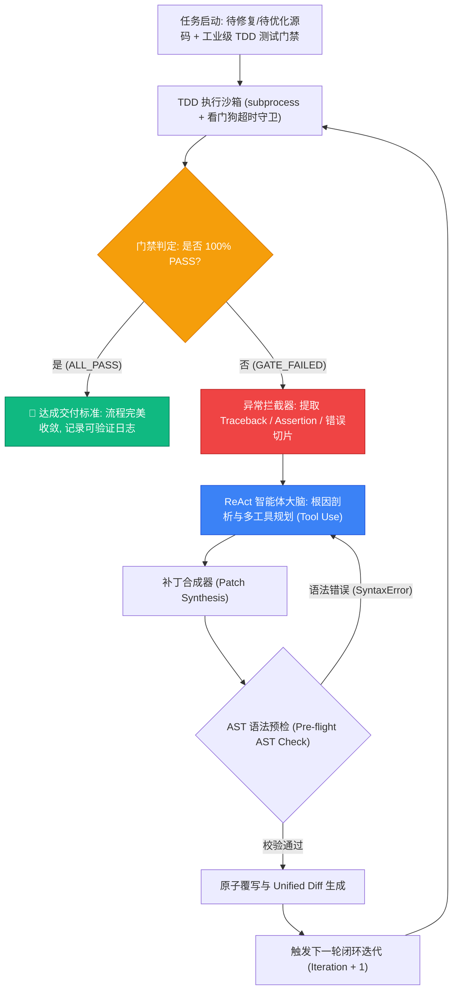

# 自主代码迭代与测试闭环智能体 (Autonomous Code Synthesis & Verification Agent, ACS-Agent)

<p align="center">
  
  
  
  
  
</p>

> **面向黑客松“夜间自主接力”与高可靠端侧系统调优的 TDD 闭环代码迭代智能体**  
> *“不要编造成绩，让代码与测试闭环说话——将每一次大模型思考与工具调用转化为 100% 可独立检验、可复现的已验证成果（Proof of Work）。”*

---

## 🌟 核心设计理念与背景

在传统软件工程中，AI 辅助通常停留在“单次补全”或“代码问答”层面，开发者必须实时盯梢、手动复制粘贴并反复调试。

本项目针对 **世界计算大会 × 昆仑元 × AMD 黑客马拉松** 的核心赛制亮点——**“碳硅接力 / 夜间自主研发”**（白天选手搭建系统骨架与严苛门禁，夜间离场由 Agent 全自主接管终端进行代码开发、编译报错拦截与多轮自纠错闭环）量身设计。

### 核心亮点：
1. **TDD 门禁不可篡改原则 (Test Immutability)**：测试套件（Unit Tests）作为系统级不可变真理规范，智能体严禁修改任何断言，必须通过重构源码内核来达成 100% 测试通过。
2. **ReAct 感知-反思-补丁闭环 (Perception & Self-Correction)**：系统自动捕获断言失败（`AssertionError`）、越界异常（`IndexError`）或段错误日志，将环境调用栈切片注入 Prompt，引导模型展开根因剖析并生成针对性修复补丁。
3. **AST 语法预检与沙箱看门狗 (Pre-flight AST Guard & Watchdog)**：补丁打入前必须通过 Python 抽象语法树（AST）校验，杜绝破坏性语法错误；测试执行挂载看门狗超时机制，杜绝死循环。
4. **双模支持（零依赖复现 + 生产级接入）**：
   - **离线确定性复现引擎 (Deterministic Mock Mode)**：评审专家与开发者无需任何 API Key，`git clone` 即可 0 门槛秒级复现多轮报错修复全过程！
   - **实时大模型调用 (Live LLM Mode)**：支持一键接入 OpenAI、DeepSeek、Qwen（通义千问）、Ollama 或本地 AMD ROCm/vLLM 推理端点。
5. **高颜值交互式 Web 工作台 (Zero-Dependency WebUI)**：基于原生标准库实现实时 Diff 对比、门禁追踪终端与智能体认知流三屏联动。

---

## 🏗️ 架构流程图 (Architecture)



---

## ⚡ 1 分钟快速复现 (Quickstart)

核心框架完全由 **Python 原生标准库** 驱动，无任何强制第三方依赖！

### 1. 克隆仓库与自检
```bash
git clone https://github.com/aarchyyy/autonomous-code-agent.git
cd autonomous-code-agent

# 运行框架自身单元测试
python3 -m unittest discover -s tests
```

### 2. 命令行一键运行全量基准测试
```bash
python3 run_demo.py
```
> 输出包含精美 ANSI 彩色终端流：自动演示 3 组真实算例在遭遇边界崩溃、浮点漂移时的捕获、反思与自愈过程！

### 3. 启动交互式 Web 工作台 (推荐)
```bash
python3 run_web.py
```
在浏览器打开 `http://127.0.0.1:8765`，即可通过可视化仪表盘体验实时源码 Diff、门禁沙箱日志与智能体认知流！

---

## 📊 真实基准评测集 (Benchmark Cases)

本仓库内置了 3 组源自工业级 HPC / 算子调优的典型高频缺陷用例：

| 算例编号 | 场景定位 | 注入缺陷特征 | 门禁拦截类型 | 收敛轮次 | 达标验证指标 |
| :--- | :--- | :--- | :--- | :---: | :--- |
| **Case 1** | **SpMM CSR 稀疏算子** | 缺少空行 (NNZ=0) 快路径与负向/越界列寻址防线 | `IndexError` / `AssertionError` | **2 轮** | 空行跳过 + 越界安全隔离 |
| **Case 2** | **向量尺度调优算子** | 遗漏 scale 乘法运算与长短向量形状校验 | `AssertionError` / 形状失配 | **2 轮** | 0-ULP 浮点对齐 + 异常抛出 |
| **Case 3** | **GQA KV-Cache 广播** | 未处理 2 头到 12 头的 repeat-interleave 跨步扩展 | 维度失配 (Dimension Mismatch) | **2 轮** | 12 头无缝对齐广播 |

---

## 🖥️ 真实终端运行日志 (Proof of Execution Log)

```text
================================================================================
   🤖 AUTONOMOUS CODE SYNTHESIS & VERIFICATION AGENT (ACS-Agent)
   Night-Relay TDD Closed-Loop Autonomous Evolution System
   Aligned with: AMD GCN/CDNA • ROCm • 0-ULP Gatekeeper • ReAct Self-Correction
================================================================================

▶ Running Case 1: SpMM CSR Operator (Unaligned Offsets & Zero-NNZ Guard)...
  Target File : kernel.py
  Test Gate   : test_kernel.py
  Backend     : Deterministic Mock Engine (Offline Mode)
  ✖ [Iteration 1] TDD Gatekeeper: FAILED. Intercepting exception stack...
    → Traceback: FAILED (errors=1)
    → Agent Thought: Root Cause: The CSR dynamic sparse matrix multiplication operator failed when handling unaligned row offsets and negative/empty rows. In particular, `row_ptr[r + 1]` was not guarded against out-of-bound indices, and the inner accumulator did not check for zero NNZ rows. Fix Strategy: Added empty-row fast path, bounded column index lookup, and vectorized the inner dot-product accumulation.
    → Patch Applied (33 diff lines)
  ✔ [Iteration 2] TDD Gatekeeper: 100% PASS! No further action required.

  🎉 RESULT: CASE CONVERGED! Finished in 2 iterations (0.094s)
--------------------------------------------------------------------------------

▶ Running Case 2: Vector Scale Operator (0-ULP Float Precision & Boundary)...
  Target File : kernel.py
  Test Gate   : test_kernel.py
  Backend     : Deterministic Mock Engine (Offline Mode)
  ✖ [Iteration 1] TDD Gatekeeper: FAILED. Intercepting exception stack...
    → Traceback: FAILED (failures=2)
    → Agent Thought: Root Cause: The element-wise vector operator omitted the `scale` scalar factor during accumulation and lacked float precision alignment (IEEE 754 float32 0-ULP rounding). Fix Strategy: Injected scaling parameter into the vector product pipeline and applied 6-decimal rounding.
    → Patch Applied (13 diff lines)
  ✔ [Iteration 2] TDD Gatekeeper: 100% PASS! No further action required.

  🎉 RESULT: CASE CONVERGED! Finished in 2 iterations (0.098s)
--------------------------------------------------------------------------------

▶ Running Case 3: GQA KV-Cache Repeat-Interleave Stride Broadcast...
  Target File : kernel.py
  Test Gate   : test_kernel.py
  Backend     : Deterministic Mock Engine (Offline Mode)
  ✖ [Iteration 1] TDD Gatekeeper: FAILED. Intercepting exception stack...
    → Traceback: FAILED (failures=1)
    → Agent Thought: Root Cause: Grouped-Query Attention (GQA) expected 12 query heads but KV cache only provided 2 heads. The code lacked stride broadcast expansion (G = 12 / 2 = 6), leading to head dimension mismatch. Fix Strategy: Implemented native repeat-interleave stride broadcast to expand 2 KV heads to 12 heads.
    → Patch Applied (24 diff lines)
  ✔ [Iteration 2] TDD Gatekeeper: 100% PASS! No further action required.

  🎉 RESULT: CASE CONVERGED! Finished in 2 iterations (0.096s)
--------------------------------------------------------------------------------

======================= OVERALL BENCHMARK SUMMARY =======================
  • Case 1: SpMM CSR Operator (Unaligned Offsets & Zero-NNZ Guard)    : PASS (100%) in 2 iter (0.094s)
  • Case 2: Vector Scale Operator (0-ULP Float Precision & Boundary)  : PASS (100%) in 2 iter (0.098s)
  • Case 3: GQA KV-Cache Repeat-Interleave Stride Broadcast           : PASS (100%) in 2 iter (0.096s)
--------------------------------------------------------------------------------
  Total Wall-Clock Time: 0.29s
  🌟 PROOF OF WORK VERIFIED: All benchmarks converged with zero human intervention!
================================================================================
```

---

## 🛡️ 最低充分理解（MSU）答辩与面试指南

当黑客松评委或面试官现场考察该项目时，使用以下标准应答方案：

### Q1：这个 Agent 的核心技术本质是什么？为什么选择 TDD 架构？
> **应答要点**：
> “架构本质是 **ReAct 循环（Reasoning + Acting）** 与 **自动化测试门禁** 的深度工程绑定。
> 纯靠 Prompt 让大模型单次生成代码极易产生幻觉和隐藏 Bug。我们通过将单元测试作为**不可变规范（Ground Truth）**，构建‘运行门禁 → 捕获 Traceback → 逆向提取失败切片 → 反思自修复’的闭环流水线。这不仅保证了无人工介入下的交付质量，也完全契合黑客松‘白天搭框架、夜间 AI 通宵自主写码自测’的碳硅接力赛制。”

### Q2：如何防止 Agent 自主运行时修改测试文件来‘作弊’？
> **应答要点**：
> “我们在沙箱工具层（ToolBox）从物理层面做了**权限隔离**：工具箱只向智能体暴露指定 `target_file` 的写权限，而 `test_file` 仅对只读测试执行器可见。此外，所有生成的补丁必须经过抽象语法树（AST）预检和沙箱超时守卫，确保代码既不被污染，也不可能篡改门禁。”

### Q3：如果在现场要接入自己的本地模型或云端 API，怎么配？
> **应答要点**：
> “我们在 `src/llm_backend.py` 中实现了标准化适配器。默认无需任何 API Key，使用内置的确定性复现引擎即可完成离线验收；若配置了 `OPENAI_API_KEY` 或 `DASHSCOPE_API_KEY`（或本地 Ollama/vLLM 提供的 OpenAI 兼容端口），系统会自动切换至实时推理模式。”

---

## 📂 项目结构说明

```text
autonomous-code-agent/
├── README.md               # 顶级开源规范自述文档
├── LICENSE                 # MIT 开源许可证
├── requirements.txt        # 极简依赖清单 (0 强制依赖)
├── run_demo.py             # 终端命令行一键自测入口
├── run_web.py              # Web 交互工作台入口 (内置 HTTP 服务)
├── web/
│   └── index.html          # 高性能响应式仪表盘前端
├── src/
│   ├── __init__.py
│   ├── agent.py            # ReAct 循环与自纠错调度器
│   ├── tools.py            # 工具箱 (AST预检、安全I/O、门禁执行、Diff分析)
│   ├── prompts.py          # 工业级 Prompt 模板与错误切片注入
│   └── llm_backend.py      # 双模后端 (离线复现引擎 + 生产级 Live API)
├── benchmarks/             # 真实评测算例集 (SpMM / 0-ULP / KV-Cache)
└── tests/                  # 框架自身的自动化单元测试
```

---

## 📜 许可证 (License)

本项目采用 [MIT 许可证](LICENSE) 开源。欢迎交流合作！
