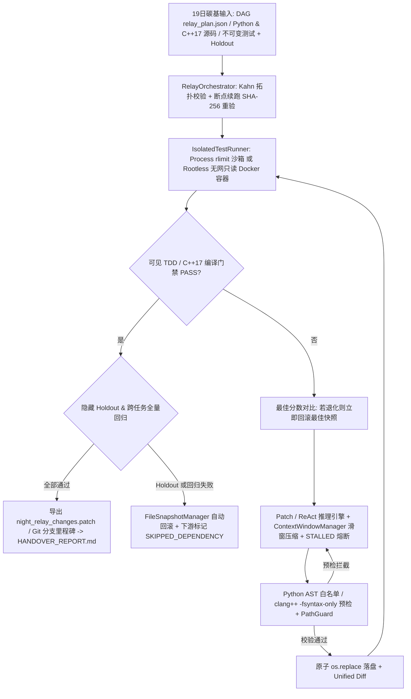

# 自主代码迭代与可信验证智能体 (ACS-Agent · Complete Edition)

<p align="center">
  
  
  
  
  
  
</p>

> **面向 24h「碳硅接力」夜间自主研发赛制的工程级多语言 TDD 闭环代码智能体（完全体）**  
> 让人类在白天定义 DAG 任务拓扑、接口骨架与不可变门禁，让 Agent 在夜间双层安全沙箱（进程级 `rlimit` 或无网只读 Docker 容器）内自主探索、修改、编译测试、防退化回滚、断点续跑，并在清晨交付可审计的 `HANDOVER_REPORT.md` 与 `night_relay_changes.patch` 补丁包。

---

## 🎯 核心架构与完全体特性

针对 **24h 人机接力赛制**（19日碳基主场 → 夜间全员撤场硅基接力 → 20日接续优化）与异构算力底座（**昆仑芯 AI Agent Gateway / GPT-Factory One**、**AMD Ryzen AI MAX+ 395 本地推理**、**vLLM / ROCm**），完全体包含五大核心子系统：

1. **24h DAG 接力编排、断点重验续跑与统一补丁导出 (`src/relay.py` + `run_relay.py`)**：
   - **拓扑依赖调度 (`depends_on`)**：自动做 Kahn 拓扑排序与环路检测；若上游任务未收敛，仅将下游依赖分支标记为 `SKIPPED_DEPENDENCY`，**互不依赖的平行分支继续推进**。
   - **三维预算熔断与跨任务回归守卫**：同时受墙钟时间 (`max_total_seconds`)、Token 预算 (`max_total_tokens`) 与连续失败熔断器 (`max_consecutive_failures`) 约束；每完成一个任务立即重跑所有历史已完成任务的可见门禁与隐藏 Holdout，一旦破坏前序任务立刻触发 `REGRESSION_ROLLED_BACK` 自动回滚。
   - **崩溃安全断点续跑 (`--resume <run_dir>`)**：夜间断电或中断重启时，自动对历史成功任务执行 **SHA-256 + 可见测试 + Holdout 重验**，零 Token 开销秒级恢复为 `RESUMED_VERIFIED` 并从中断处接续执行。
   - **晨间四件套交付**：自动产出 `HANDOVER_REPORT.md`、`handover_summary.json`、`audit_events.jsonl` 以及可直接 `git apply` 的汇总补丁 **`night_relay_changes.patch`**（同时支持 `--git-branch` 隔离分支里程碑提交）。

2. **双层执行沙箱：用户态 `rlimit` + Rootless 无网只读 Docker 容器 (`src/sandbox.py`)**：
   - **Tier 1 进程隔离 (`--sandbox process`)**：临时目录拷贝（隔离隐藏 `hidden_files`）、受保护文件 `0o444` 只读、剔除 `*KEY*`/`*TOKEN*`/`*SECRET*` 等敏感环境变量、`python -I`、POSIX `RLIMIT_CPU`/`RLIMIT_FSIZE`（Linux 含 `RLIMIT_AS`）与 `os.killpg` 进程组超时强杀。
   - **Tier 2 容器级内核隔离 (`--sandbox docker` / `auto`)**：通过 `docker run --rm --network none --read-only --tmpfs /tmp:rw,nosuid,size=64m --cap-drop ALL --security-opt no-new-privileges --pids-limit 64 --user 65534:65534 -v <stage>:/workspace:ro` 提供断网、只读根文件系统、全 Linux Capability 剥离与超时容器强杀清理。
   - **细粒度静态策略与多语言预检 (`ASTPolicyInspector` & `NativeSyntaxInspector`)**：Python 支持 `strict_ast=True` 叠加 `allowed_imports` / `allowed_calls` 精细白名单；C/C++/HIP (`.cpp`/`.hpp`/`.hip`) 在落盘前自动执行 `clang++`/`g++`/`hipcc -std=c++17 -fsyntax-only` 语法与类型预检，并在沙箱内编译运行原生二进制门禁。
   - **SHA-256 完整性监控 (`IntegrityMonitor`)**：每次门禁执行前后双次校验测试与 Holdout 文件 SHA-256。

3. **多文件 ReAct + 上下文滑窗压缩 + 全模式防停滞熔断 (`src/agent.py`, `src/context.py`, `src/tools.py`)**：
   - **6 项受控沙箱工具**：`list_files`、`read_file`、`search_code`、`patch_file`（支持行尾空白归一化唯一块回退匹配）、`write_file`（临时文件 + `os.replace` 原子替换）、`run_tests`（不暴露任意 Shell）。
   - **双协议自动降级 (`LiveLLMClient`)**：原生 OpenAI `tools` 遇本地网关 `HTTP 400` 时无缝降级至文本 `[TOOL_CALL] {...} [/TOOL_CALL]` 协议，兼容 `<think>...</think>` 思考链提取。
   - **确定性上下文滑窗压缩 (`ContextWindowManager`)**：长程多文件探索超过上下文阈值时，在严格保持 `assistant(tool_calls)` 与 `tool` 消息配对的前提下，将早期大体积 `read_file`/`run_tests` 观测折叠为结构化摘要并统计回收 Token 数。
   - **Patch + ReAct 全模式防退化与防停滞 (`STALLED`)**：分数倒退自动回滚至最佳快照；无论是 Patch 还是 ReAct 模式，连续陷入相同 `(state_hash, error_signature)` 或重复无效工具调用均会提前以 `STALLED` 熔断。

4. **无泄漏未知题泛化与 8 项红队对抗评测套件 (`src/evaluator.py` + `run_eval.py`)**：
   - **8 项主动红队攻击探针 (`--mode redteam`)**：实测验证路径穿越、软链逃逸、篡改测试文件、高危 AST 注入与白名单放行、死循环看门狗强杀恢复、Holdout 拦截硬编码作弊、DAG 跨任务破坏回滚与下游跳过、以及离线 Mock 在未知题库上 **0% 通过率零泄漏审计**。
   - **4 道跨领域未知评测集 (`UNSEEN_EVAL_PROBLEMS`)**：涵盖 `TTLCache`、多文件 `TenantRateLimiter`、IEEE-754 `float32` 对称 `INT8` 量化器与 C++17 `RingBuffer`，配套本地多故障注入 HTTP 压测模拟器 (`--mode fault-sim`) 与真实模型直连评测 (`--mode live`)。

---

## 🏗️ 系统架构图



---

## ⚡ 快速开始与验证

框架核心、评测器及实时 Web 工作台完全基于 **Python 3.9+ 标准库**（零第三方强制依赖）。

### 1. 运行全量单元与对抗测试
```bash
python3 -m unittest discover -s tests -v
```

### 2. 运行安全红队对抗与多故障未知题 HTTP 压测 (`run_eval.py`)
```bash
# 一键执行 8 项安全红队探针 + 4 道未知题多故障 HTTP 闭环压测
python3 run_eval.py --mode all-offline

# 接入真实推理端点评测 4 道零泄漏未知题泛化能力
python3 run_eval.py --mode live --preset kunlun-gateway --model baize-omni-sense
```

### 3. CLI 单任务 / 全量基准演练（Python + C++17 + Docker 容器沙箱）
```bash
# 跑通内置 Case 1-5（含 Case 5 C++17 编译门禁）
python3 run_demo.py --mode mock

# 使用无网只读 Rootless Docker 容器沙箱运行 Python 算例
python3 run_demo.py --mode mock --case case2 --sandbox docker --docker-image python:3.12-alpine

# 连接本地 Ollama / vLLM / 昆仑 GPT-Factory One 运行自定义工程
python3 run_demo.py --mode live --preset ollama --model qwen2.5-coder:14b \
  --workspace /path/to/project --target kernel.hpp --test test_kernel.cpp --gate-runner cpp
```

### 4. 启动 24h DAG 夜间接力与断点续跑 (`run_relay.py`)
```bash
# 隔离演练 5 任务 DAG 夜间接力计划，生成 HANDOVER_REPORT.md 与 night_relay_changes.patch
python3 run_relay.py --mode mock

# 从中断目录重验 SHA-256 并零 Token 续跑剩余任务
python3 run_relay.py --mode live --preset kunlun-gateway --workspace /path/to/repo \
  --plan relay_plan.json --resume .acs_runs/20261119-023000 --git-branch
```

### 5. 启动零依赖实时 SSE 双模 Web 工作台 (`run_web.py`)
```bash
python3 run_web.py --port 8765
```
访问 `http://127.0.0.1:8765`，支持切换 `Process` / `Docker` 沙箱、运行 Case 1–5（含 C++17）、监控上下文滑窗压缩次数、执行 DAG 夜间接力并一键下载 `HANDOVER_REPORT.md` 与 `night_relay_changes.patch`。

---

## 📊 内置基准集 (Cases 1–5) 与未知泛化题库 (U1–U4)

| 编号 | 模块 / 语言 | 核心工程与数值验收契约 | 门禁构成 |
| :--- | :--- | :--- | :--- |
| **Case 1** | `case1_spmm_boundary` (Python) | CSR `row_ptr` 单调性、拒绝负列下标 (`dense_b[-1]`) 与越界下标、空行跳过、`math.fsum` 补偿求和 | `test_kernel.py` (6 项) |
| **Case 2** | `case2_vector_scale` (Python) | `struct.pack("!f", ...)` IEEE-754 `float32` 比特级 `0-ULP` 对齐（封杀 `round(..., 6)` 截断）、非有限值检查 | `test_kernel.py` (7 项) |
| **Case 3** | `case3_kv_cache_broadcast` (Python) | GQA 头整除校验、多 Batch/Seq 形状检查、深拷贝独立缓冲防别名污染 | `test_kernel.py` (4 项) |
| **Case 4** | `case4_relay_scheduler` (Python ReAct) | `precision.py` + `scheduler.py` 多文件协同：补偿求和、字典序平局裁决、Token 预算与防输入篡改 | 可见 3 项 + Holdout 2 项 |
| **Case 5** | `case5_cpp_csr_spmv` (**C++17**) | 4 路展开 CSR SpMV：补齐 `nnz % 4 != 0` 标量尾部清理、CSR 越界异常、拓宽 `double` 累加防 `1e8f` 相消精度丢失 | `clang++` 编译可见 5 项 + Holdout 2 项 |
| **U1–U4** | `src/evaluator.py` (Python + **C++17**) | **零泄漏未知题库**：`TTLCache`、多文件 `TenantRateLimiter`、对称 `INT8` 量化器、C++17 `RingBuffer` | 每题均含可见门禁 + 隐藏 Holdout |

---

## ⚠️ 验证口径与工程边界声明

1. **严格区分 Offline Smoke Mock、Fault-Sim 与 Live LLM**：
   - `DeterministicMockLLM` 仅对内置 Case 1–5 返回固定补丁以冒烟验证沙箱与调度流水线，在未知题库 `U1–U4` 上得分为 **0/4 (`MOCK_UNSUPPORTED_TASK`)**；
   - `run_eval.py --mode fault-sim` 验证的是本地真实 HTTP 协议栈在注入语法错误、HTTP 400 降级、上下文膨胀与 C++ 头文件报错下的多轮自愈闭环；
   - 评估具体大模型的真实代码生成泛化率，请务必使用 `--mode live` 连接实际模型端点。
2. **双层沙箱适用范围**：
   - 默认 `--sandbox process` 使用用户态只读临时副本与 POSIX `rlimit`，开箱即用；执行高风险不可信代码时请显式开启 `--sandbox docker` 启用 `--network none --read-only --cap-drop ALL` 容器级隔离（C++ 编译门禁若需在容器内运行，需指定包含 `g++`/`clang++` 的镜像）。

## 📜 许可证

本项目采用 [MIT 许可证](LICENSE) 开源。
